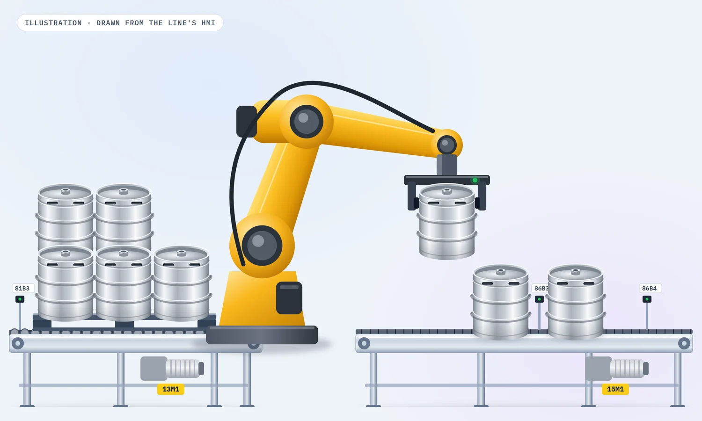

import Quote from '../../../components/mdx/Quote.astro';
import StatStrip from '../../../components/mdx/StatStrip.astro';
import Callout from '../../../components/mdx/Callout.astro';
import KegCell from '../../../components/mdx/KegCell.astro';

ถัง Keg เบียร์ที่ไปส่งตามร้านแล้ว จะถูกเก็บกลับมาที่โรงเบียร์เป็น **ถังเปล่าเรียงบนพาเลท** ครับ
ก่อนจะล้างและบรรจุใหม่ได้ ต้องมีคนหรือเครื่องจักรยกถังลงจากพาเลททีละใบ แล้วส่งเข้าคอนเวย์เยอร์
ไลน์ที่เราได้ทำในบทความนี้ใช้ **Robot ที่มีกล้อง Vision** ทำหน้าที่นั้น ส่วนพาเลทเปล่าจะวิ่งต่อไปซ้อนกันที่ Stacker รอรถโฟล์คลิฟท์มายก

ตัวไลน์ยังดีอยู่ แต่สมองของมันคือ **PLC S7-300** ที่อายุมากแล้ว งานของเราคือย้ายโปรแกรมทั้งหมดขึ้น **S7-1500**
คุมคอนเวย์เยอร์ทุกตัวให้ทำงานเหมือนเดิม ออกแบบ **สัญญาณที่ PLC กับ Robot คุยกันผ่าน PROFIBUS** ใหม่ให้อ่านออก
แล้วทำ **หน้าจอ HMI** ที่ใช้ทั้งสั่งงาน ดู I/O และเก็บข้อมูลไว้ย้อนดูได้ครับ

<Quote en="Every bit between PLC and robot has one owner and one meaning." kicker="// PROJECT LOG · KEG LINE">
ทุกบิตระหว่าง PLC กับ Robot ต้องมี**เจ้าของคนเดียว** และมี**ความหมายเดียว**
</Quote>

<StatStrip items={[
  { value: '6', label: 'มอเตอร์คอนเวย์เยอร์ (11M1–16M1)' },
  { value: '16 + 16', label: 'บิต PROFIBUS ไป-กลับ PLC ↔ Robot' },
  { value: '26', label: 'ข้อความ Alarm พร้อมสาเหตุและวิธีแก้' },
  { value: '4', label: 'ขนาดถัง KEG 15 / 20 / 30 / 50' },
]} />

## ไลน์นี้ทำอะไร

| จุด | อุปกรณ์ | หน้าที่ |
|---|---|---|
| ทางเข้าพาเลท | 11M1 + ม่านแสงคนเข้า 2 จุด | รับพาเลทจากโฟล์คลิฟท์ ถ้ามีคนเข้าพื้นที่ไลน์จะหยุด (F010, F011) |
| ส่งต่อ | 12M1 | พาพาเลทไปจุดหยิบ มีเวลากำกับทุกช่วง (F031, F032) |
| จุดหยิบ | 13M1 + Stopper + Pusher | หยุดพาเลทให้ตรงตำแหน่ง จับให้นิ่ง แล้วให้ Robot ยกถังลง |
| คอนเวย์เยอร์ถัง | 15M1 เดินหน้า/ถอยหลัง | รับถังจาก Robot ส่งต่อไปขั้นถัดไป |
| ไลน์ Eject | Pusher + เซนเซอร์ Buffer | แยกพาเลทหรือถังที่ต้องคัดออก |
| Stacker | 14M1 + กระบอกขึ้นลง | ซ้อนพาเลทเปล่า เต็มแล้วเปิดไฟเตือนให้โฟล์คลิฟท์มายก |

## ย้ายจาก S7-300 มา S7-1500 โดยที่เครื่องไม่รู้ตัว

กติกาของงานอัปเกรดแบบนี้ง่ายมากครับ **คนหน้างานต้องไม่รู้สึกว่าเครื่องเปลี่ยน** ลำดับการทำงาน, เวลารอ, เงื่อนไข Interlock ต้องเหมือนเดิมทุกอย่าง

- **ฮาร์ดแวร์ใหม่** CPU 1515-2 PN กับโมดูล ET200MP แบบ DI 32 / DQ 32 และโมดูล CM 1542-5 สำหรับ PROFIBUS ไปหา Robot
  ส่วน HMI เป็น TP1200 Comfort ต่อกับ PLC ผ่าน PROFINET
- **ตาราง I/O ก่อนโค้ด** เราทำตาราง Tag ใน Excel ก่อน 64 Input และ 32 Output ทุกจุดมีชื่อที่บอกว่าเป็นอุปกรณ์อะไร
  เช่น `PH108_14M1`, `RS STACKER UP`, `15M1 START REWARD` ในรูปแบบเดียวกับ Tag Table ของ TIA Portal ช่างเดินสายกับโปรแกรมเมอร์ใช้ตารางเดียวกัน
- **รักษาโครงโปรแกรมเดิม** โปรแกรมเดิมแบ่งเป็น FC ตามหน้าที่อยู่แล้ว เราย้ายมาโดยคงโครงนั้นไว้ แล้วค่อยเพิ่มส่วนใหม่
  (Robot, Alarm, Log) เป็นบล็อกแยก วิศวกรของโรงงานที่คุ้นกับโปรแกรมเดิมจะหาของเจอในที่เดิม
- **ทุกการเคลื่อนที่ของพาเลทมีนาฬิกา** ถ้าพาเลทออกจากเซนเซอร์หนึ่งแล้วไม่ถึงเซนเซอร์ถัดไปในเวลาที่ตั้งไว้ จะขึ้น Alarm ทันที
  (F031 ถึง F043) ดีกว่าปล่อยให้มอเตอร์หมุนลากพาเลทที่ติดอยู่ไปเรื่อยๆ

<Callout type="tip" title="ตารางเดียว ใช้ได้ทั้งตู้และโค้ด">
ไฟล์ Tag ที่ทำไว้ตั้งแต่วันแรกกลายเป็นเอกสารที่ถูกเปิดบ่อยที่สุดในงานนี้ครับ ใช้ตอนเดินสาย ตอนเช็ค I/O
ตอนทำหน้าจอ I/O Monitor และตอนหาว่าทำไมเซนเซอร์ตัวหนึ่งไม่ติด ชื่อ Tag ที่มีชื่อมอเตอร์ติดอยู่ เช่น `PH105_12M1`
บอกได้ทันทีว่าเซนเซอร์ตัวนี้อยู่บนคอนเวย์เยอร์ตัวไหน
</Callout>

## PLC กับ Robot คุยกันด้วย 16 บิต

Robot มี Controller ของตัวเอง ส่วน PLC คุมทุกอย่างที่อยู่รอบตัวมัน ทั้งสองฝั่งจึงต้องตกลงกันให้ชัดว่า
**ใครบอกอะไร เมื่อไหร่** ในงานนี้ใช้ PROFIBUS DP ฝั่งละ 16 บิต และเราวางชื่อให้ฝั่งขาไปกับขากลับเป็นคู่กัน

| PLC → Robot | Robot → PLC | ใช้ทำอะไร |
|---|---|---|
| MOTOR ON STATE, MASTER MAIN | MOTOR ON STATE, MASTER MAIN | ยืนยันว่าทั้งสองฝั่งพร้อม |
| CYCLE ON | CYCLE ON | PLC สั่งเริ่มรอบ Robot ตอบว่ากำลังทำงาน |
| RUN CHAIN OK | RUN CHAIN OK | คอนเวย์เยอร์ถังพร้อมรับ ถ้าไม่พร้อม Robot ต้องไม่วางถัง |
| CYCLE STOP, GO HOME POSITION | CYCLE STOP, HOME POSITION | จบรอบและกลับจุด Home อย่างเป็นขั้นตอน |
| RESET EXECUTION, RESET EMERGENCY STOP | EXECUTION ERROR, EMERGENCY STOP | Robot แจ้งปัญหา PLC ส่ง Reset หลังคนแก้ไขแล้ว |
| PRESSURE VALVE | VISION READY, AUTO ON | ลมพร้อม กล้องพร้อม Robot อยู่ในโหมด Auto |
| CH PROFIBUS | OK PROFIBUS | คู่บิตเช็คการสื่อสาร ถ้าไม่ตอบกลับขึ้น F15 |
| | DOOR VISION, DOOR SAFETY | สถานะประตูรอบ Robot |

ลองกด **Start** ดูรอบการทำงาน แล้วลองใส่ Fault ทีละตัว จะเห็นว่าบิตฝั่งไหนเปลี่ยน ไลน์หยุดที่สเต็ปไหน และ Log บันทึกอะไรไว้ครับ

<KegCell />

สิ่งที่เราได้เรียนรู้จากส่วนนี้คือ **อย่าคิดว่าบิตชื่อเดียวกันแปลว่าสิ่งเดียวกัน** "CYCLE ON" ฝั่ง PLC คือคำสั่ง แต่ฝั่ง Robot คือสถานะ
ถ้าไม่เขียนให้ชัดตั้งแต่แรก ตอน Commissioning จะเสียเวลาเถียงกันว่าใครควรรอใคร
เราจึงทำหน้า **Robot I/O Monitor** บน HMI ให้เห็นทั้ง 32 บิตแบบสด ช่างไม่ต้องเปิดโน้ตบุ๊กก็รู้ว่า Robot กำลังรออะไรอยู่

## HMI ที่ใช้สั่งงาน และย้อนดูได้

| หน้าจอ | สิ่งที่ทำได้ |
|---|---|
| Overview | เลือก Program Number ตามขนาดถัง (KEG 15/20/30/50), กด Reset ค้าง 3 วินาที, ดูโหมด, สเต็ป, ไฟ Tower และชั่วโมงการทำงาน |
| Home | เปลี่ยนโหมดพร้อมหน้าต่างยืนยัน กันการกดพลาด |
| Main Menu | ล็อกอินตามระดับผู้ใช้, หน้า Interlock, เมนู Maintenance, Alarm และ Setting |
| Maintenance | I/O Monitor, Robot I/O Monitor และสั่ง Output ทีละจุดของช่วงพาเลทเข้า, ไลน์ Eject และ Stacker |
| Setting | ตั้งชั่วโมงบำรุงรักษาของมอเตอร์แต่ละตัว เทียบกับชั่วโมงที่วิ่งจริง และปุ่ม **Logging Step** ดึงประวัติสเต็ปตามเวลา |
| Network | Diagnostic ของ PLC, HMI และ Robot ในหน้าเดียว |

ข้อมูลที่ HMI เก็บมี 2 อย่างที่ช่างใช้จริงครับ
**ชั่วโมงการทำงานของมอเตอร์** ใช้วางแผนบำรุงรักษา ตั้งค่าเป้าไว้ได้แล้วรีเซ็ตหลังเปลี่ยนชิ้นส่วน
และ **Log ของสเต็ป** ที่บอกว่าเครื่องเข้าสเต็ปไหนตอนกี่โมง เวลาเครื่องค้าง คำถามแรกคือ "ค้างที่สเต็ปไหน นานเท่าไร" ซึ่งไฟล์นี้ตอบได้ทันที

<Callout type="safety" title="Alarm ที่บอกทั้งสาเหตุและวิธีแก้">
Alarm แบ่งเป็น 2 กลุ่ม **F0xx** ของไลน์ (E-stop, มอเตอร์และอินเวอร์เตอร์ Overload, คนเข้าพื้นที่, Stacker เต็ม, พาเลทเดินช้าเกินเวลา)
และ **F1xx** ของ Robot (E-stop จาก Robot, Gripper ไม่จับหรือไม่ปล่อย, หาถังไม่เจอ, กล้องหลุด, ถังซ้อน 2 ใบ, ประตูเปิด)
ทุกข้อความในคู่มือภาษาไทยมีคอลัมน์สาเหตุและวิธีแก้ ช่างกะดึกจะได้ไม่ต้องโทรหาเราตอนตีสอง
</Callout>

## Commissioning และของที่แก้หลังเดินไลน์จริง

- **ปุ่มบนตู้** E-stop, Selector Auto/Off/Manual, Start, Stop, Reset, Home, Discharge และ Selector **Pause Robot**
  ที่ให้หยุด Robot ชั่วคราวโดยไม่ต้องหยุดทั้งไลน์
- **Punch list จากการเดินไลน์กับลูกค้า** สถานะมอเตอร์เดินหน้า/ถอยหลังบนหน้าจอยังไม่ตรงกับอุปกรณ์จริง และ Alarm ของ Robot
  ไม่ขึ้นที่ตู้คอนเวย์เยอร์ถังเปล่า เราแก้ทั้งสองจุดแล้วส่งเวอร์ชันใหม่
- **ส่งมอบ** โปรเจค TIA Portal ทุกเวอร์ชันที่ลงเครื่องจริง ตาราง Tag และคู่มือ HMI ภาษาไทย 20 หน้าที่อธิบายทุกปุ่มและทุก Alarm

## ถ้าทำไลน์นี้ใหม่วันนี้ เราจะทำให้ทันสมัยขึ้นอีก 5 เรื่อง

1. **HMI แบบ High-performance** พื้นเทา สีใช้เฉพาะตอนผิดปกติ แบบในตัวอย่างข้างบน แทนภาพ 3D ที่สวยแต่แย่งความสนใจจาก Alarm
2. **Robot บน PROFINET** แทน PROFIBUS สายเดียวกับ HMI ได้ Diagnostic ละเอียดกว่า และไม่ต้องมีโมดูลแยก
3. **Handshake เป็น UDT และ State Machine** ใช้โครงแบบ PackML ให้ทุกไลน์ในโรงงานคุยกับ Robot ด้วยภาษาเดียวกัน
4. **Log ขึ้น Database แทนไฟล์ในจอ** ส่ง Step, Alarm และจำนวนถังต่อพาเลทขึ้น [Unified Namespace](/blog/unified-namespace-mqtt-ignition-grafana/)
   ให้ทีมผลิตดู OEE และหาสาเหตุที่เครื่องค้างได้เอง
5. **ทดสอบกับ Digital Twin ก่อนเข้าไซต์** จำลองพาเลท เซนเซอร์ และบิตของ Robot แบบที่เล่าไว้ใน
   [บทความ Digital Twin](/blog/digital-twin-test-before-commissioning/) เวลาหน้างานจะเหลือไว้แก้ของจริง ไม่ใช่แก้ตรรกะ

## 5 บทเรียนที่จะเอาไปใช้กับงานต่อไป

1. **งานอัปเกรด วัดผลที่คนหน้างานไม่รู้สึกว่าเครื่องเปลี่ยน** ยกเว้นตรงที่มันดีขึ้น
2. **ทำตาราง I/O ก่อนเขียนโค้ด** ชื่อ Tag ที่ดีคือเอกสารที่ไม่มีวันล้าสมัย
3. **บิตทุกตัวระหว่างเครื่องต้องมีเจ้าของและความหมายเดียว** และต้องมีหน้าจอให้เห็นแบบสด
4. **ทุกการเคลื่อนที่ต้องมีนาฬิกา** Timeout ที่ดีเปลี่ยน "เครื่องค้าง" เป็น "Alarm ที่บอกตำแหน่ง"
5. **คู่มือภาษาของคนใช้งาน** Alarm ที่มีสาเหตุและวิธีแก้เป็นภาษาไทย ช่วยหน้างานมากกว่าหน้าจอที่สวย

<Quote en="Same line, same robot. New brain, clearer handshake." kicker="// END OF PROJECT · STEP 0">
ไลน์เดิม Robot ตัวเดิม · แต่**สมองใหม่** และ**คุยกันชัดขึ้น**
</Quote>

สรุปแบบ Case Study ภาษาอังกฤษอยู่ที่หน้า [Projects](/projects/2024-keg-depalletizer-robot-line/) ครับ
ถ้ากำลังวางแผนย้าย S7-300 หรือต้องเชื่อม PLC กับ Robot ทักมาคุยได้ที่หน้า [ติดต่อ](/contact/) นะครับ
