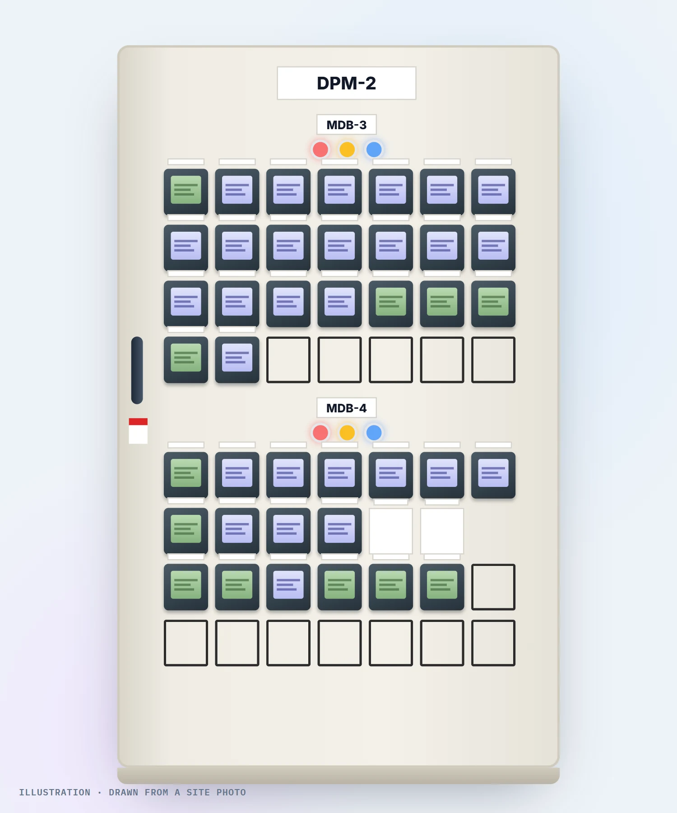
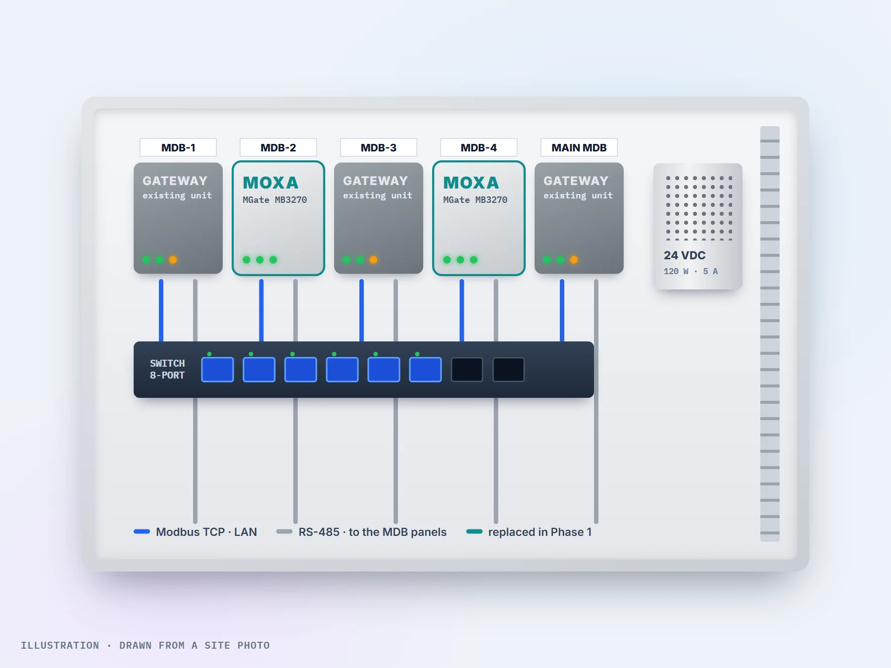
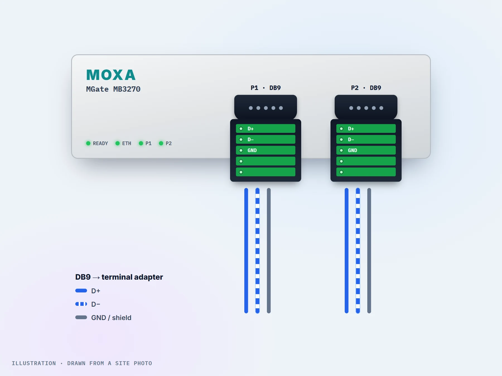
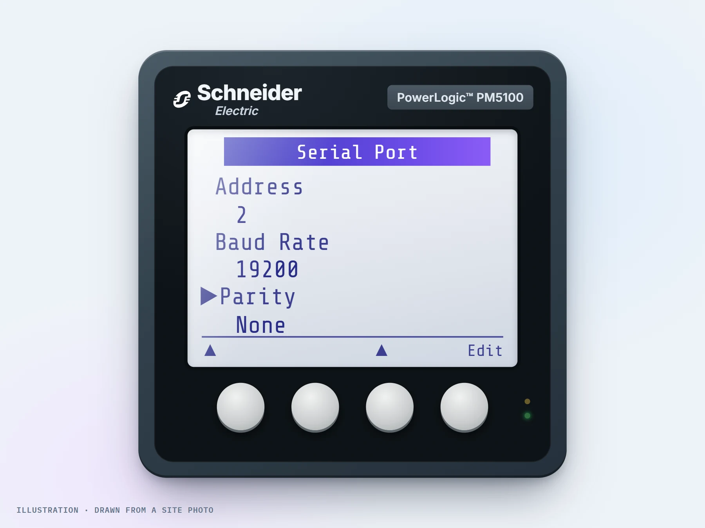
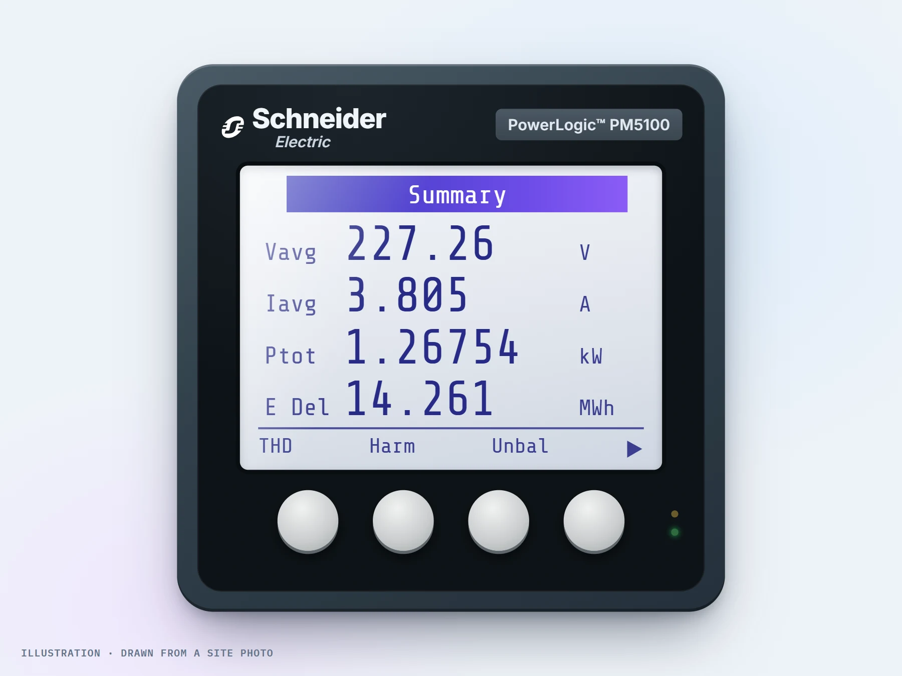

import Quote from '../../../components/mdx/Quote.astro';
import StatStrip from '../../../components/mdx/StatStrip.astro';
import Callout from '../../../components/mdx/Callout.astro';
import Checklist from '../../../components/mdx/Checklist.astro';
import Rs485Bus from '../../../components/mdx/Rs485Bus.astro';

งานนี้เริ่มจากโจทย์ที่ฟังดูง่ายมากครับ **"เปลี่ยน Modbus Gateway ของตู้ไฟ 2 ตู้"**
โรงงานใช้ Ignition ดูพลังงานไฟฟ้าจาก Power Meter หลายสิบตัวอยู่แล้ว แต่ข้อมูลของ 2 ตู้ MDB ขึ้น ๆ หาย ๆ
ทุกคนเลยสงสัย Gateway ตัวเก่าเป็นอันดับแรก

เราเปลี่ยน Gateway ได้จริง ใช้ IP เดิม ไม่ต้องแก้อะไรใน Ignition สักบรรทัด
แต่ค่าบางตัว **ก็ยังขึ้น `null` เหมือนเดิม** บทความนี้จึงเป็นเรื่องของการไล่หาว่าปัญหาจริงอยู่ตรงไหน
และสิ่งที่เราจะทำต่างออกไปถ้าได้ทำระบบนี้ใหม่ให้ทันสมัยกว่าเดิมครับ

<Quote en="New gateway, same old bus. Fix the line before you blame the box." kicker="// PROJECT LOG · POWER METER">
Gateway **ใหม่** · แต่สายยัง**เส้นเดิม**
</Quote>

<StatStrip items={[
  { value: '46', label: 'Power Meter บน RS-485 สองเส้น (MDB-2 และ MDB-4)' },
  { value: '2', label: 'Moxa MGate MB3270 แทน Gateway ตัวเดิม' },
  { value: '0', label: 'Device ใน Ignition ที่ต้องแก้ (ใช้ IP เดิม)' },
  { value: '2', unit: 'วัน', label: 'ย้าย Database ไป SQL Server ตัวใหม่แบบ Remote' },
]} />

## ภาพรวมโปรเจกต์

| หัวข้อ | รายละเอียด |
|---|---|
| ลักษณะงาน | เปลี่ยน Modbus Gateway ของระบบ Energy Monitoring ในโรงงานผลิตเครื่องปรับอากาศ และย้าย Database |
| Power Meter | Schneider PowerLogic PM5100 และ PM710MG ปนกันในตู้เดียว |
| ระบบ | Power Meter → RS-485 Modbus RTU → Moxa MGate MB3270 → Modbus TCP → Ignition Perspective → SQL Server |
| ช่วงเวลา | มี.ค. – ก.ค. 2026 (Phase 1 และรายงานสรุปปัญหา Phase 1.5) |
| ส่วนที่เราทำ | สำรวจหน้างาน ตั้งค่าและเปลี่ยน Gateway, POC, ย้าย Database, หาสาเหตุ, รายงาน, ออกแบบ Phase 2 |

เงื่อนไขของงานชัดมากตั้งแต่ใบเสนอราคา คือ **ใช้ License Ignition เดิม ไม่มีงาน PLC**
และห้ามแตะ Database หรือโปรเจคอื่นบน Server เดียวกัน ห้ามแก้หน้าจอหรือ Report ยกเว้น Database Connection
พูดง่าย ๆ คือ **เปลี่ยนชิ้นส่วนข้างล่าง โดยที่คนดูหน้าจอข้างบนต้องไม่รู้สึกอะไรเลย** ครับ

ภาพนี้วาดจากรูปตู้ DPM-2 ที่หน้างานครับ ครึ่งล่างคือมิเตอร์ของ MDB-4 ที่มีปัญหามากที่สุด
สังเกตป้าย **Spare** และช่องว่างหลายช่อง ช่องพวกนี้แหละที่จะกลับมามีบทบาทตอนท้าย

## สถาปัตยกรรม: Gateway 5 ตัวในกล่องเดียว

ในกล่อง Gateway มี Modbus Gateway 5 ตัว (MDB-1, MDB-2, MDB-3, MDB-4 และ Main MDB) ต่อเข้า Switch ตัวเดียว
แต่ละตัวแปลง Modbus TCP จาก Ignition เป็น Modbus RTU แล้วส่งไปตามสาย RS-485
สายวิ่งเข้าเทอร์มินัลในตู้ MDB แล้ว **Daisy-chain** ไปหามิเตอร์ทีละตัว MDB-2 มีราว 26 ตัว (Slave ID 2–27) ส่วน MDB-4 มีราว 20 ตัว

ใน Ignition แต่ละ Gateway คือ Modbus TCP Device หนึ่งตัว และมิเตอร์แต่ละตัวถูกอ้างด้วย Address แบบ `IP:502:SlaveID`
แปลว่าถ้าตัวใหม่ใช้ **IP เดิม** และ Serial Setting เดิม Ignition จะไม่รู้เลยว่ามีการเปลี่ยนของข้างล่าง

## เปลี่ยน Gateway โดยไม่ต้องแตะ Ignition

หน้างานจริงเราแบ่งเป็น 5 ขั้นตอนครับ

1. **ยืนยันว่า IP ไหนเป็นของตู้ไหน** ข้อมูลที่ได้มาไม่แน่ใจว่าตรงจริง เราเลยดู Status ใน Ignition Gateway
   แล้ว **ถอดสาย LAN ทีละตัว** ดูว่า Device ไหนเปลี่ยนเป็น Faulted จะได้รู้ชัวร์ ไม่ต้องเดา
2. **จดและ Backup Config ของตัวเดิม** ทั้ง IP, Subnet, Gateway, Baud rate, Data bit, Parity, Stop bit
3. **ตั้งค่า Moxa ตัวใหม่** ผ่าน MGate Manager โดยใช้ค่าจากตัวเดิมทั้งหมด
4. **Validate** เปิดหน้าเว็บของ MGate ตรวจค่าซ้ำอีกรอบก่อนลงตู้
5. **ย้ายสาย Modbus** จากตัวเดิมเข้า Moxa แล้วดู Status ใน Ignition Gateway ว่าเชื่อมต่อได้

<Checklist title="ก่อนถอด Gateway ตัวเดิม" items={[
  'ถอด LAN ทีละตัว ยืนยันว่า IP ไหนเป็นของตู้ไหน',
  'จด IP, Subnet, Gateway และ Serial Setting ครบทุกค่า',
  'Backup Config ของ Gateway เดิม และ Ignition Gateway (.gwbk)',
  'เช็คหัวต่อของตัวใหม่ว่าเป็นเทอร์มินัลหรือ DB9',
  'เช็ค Baud rate และ Parity ที่หน้าจอมิเตอร์อย่างน้อย 1 ตัว',
  'เตรียมแผนถอยกลับ: ใส่ตัวเดิมคืนได้ภายในไม่กี่นาที',
]} />

ข้อที่ 4 ของ Checklist มาจากประสบการณ์ตรงครับ พอเปิดกล่องวันแรกถึงรู้ว่าพอร์ตของ MGate MB3270 เป็น **DB9**
ไม่ใช่เทอร์มินัลขันสายแบบตัวเดิม ต้องซื้อหัวแปลง DB9-to-terminal เพิ่ม 4 ตัวกันหน้างานเลย

ส่วนค่า Serial เราไม่เชื่อเอกสารอย่างเดียว เดินไปกดดูที่หน้าจอมิเตอร์เองด้วย
มิเตอร์ตัวนี้ตั้ง Address 2, 19,200 baud, Parity None ตรงกับที่ Gateway ต้องใช้

ผลคือ Moxa แทนตัวเดิมได้ ใช้ IP เดิม **Ignition เชื่อมต่อได้ทันทีโดยไม่ต้องแก้ Device** และมีข้อมูลจากมิเตอร์เข้ามา
แต่... ข้อมูลยัง **ไม่เสถียร** ครับ

## อาการ: ค่าขึ้น ๆ หาย ๆ แบบไม่มีรูปแบบ

มิเตอร์ตัวเดียวกัน ดูคนละเวลาค่าไม่เหมือนกัน บางรอบมีค่า บางรอบเป็น `null`

- **MDB-2** มิเตอร์หลายตัวสลับ Online/Offline บางตัวค้างไม่อัปเดตเป็นช่วง ๆ
- **MDB-4** อาการหนักกว่า มีราว 5 ตัวที่เป็น `null` ตลอด
  และมีมิเตอร์ **ต้นสาย** ที่เสียและถูก Disable ไว้ แต่สถานะกระพริบตลอดเวลา แล้วลากตัวอื่นในสายเดียวกันให้ค้างตาม

ถ้าปัญหาอยู่ที่ Gateway ใหม่ ทุกตัวควรเป็นเหมือนกัน แต่ที่เห็นคือบางตัวดี บางตัวแย่ และ **แย่ตามตำแหน่งบนสาย**
เราเลยทำ POC แยกออกมาก่อน

## POC: ตัด Bus ให้เหลือ 4 ตัว แล้วดูว่าใครผิด

ชุดทดสอบเล็ก ๆ คือ Power Supply 24 VDC → Gateway ตัวใหม่ → เทอร์มินัล 485+/− → มิเตอร์ 4 ตัว → Switch → SCADA
**ผลคือสำเร็จ** ระบบรับค่าและแสดงผลต่อเนื่องไม่มีหลุดเลยครับ

นี่คือจุดที่ทำให้ทุกอย่างชัดขึ้น เมื่อสายสั้น อุปกรณ์น้อย และเดินถูกต้อง Moxa กับ Ignition ทำงานปกติ
**ปัญหาหลักจึงอยู่ที่สาย RS-485 และอุปกรณ์บนสายเดิม ไม่ใช่ตัว Gateway**

สมมติฐานที่เข้ากับอาการที่สุดคือ มิเตอร์ที่เสียอยู่ต้นสายยังต่อสาย A/B อยู่ และยังรบกวนคู่สายที่ใช้ร่วมกัน
เพราะ RS-485 คือสายคู่เดียวที่ทุกตัวต้องแชร์กัน ตัวเดียวพูดเพี้ยน ตัวอื่นก็ฟังไม่รู้เรื่องไปด้วย
การกด Disable ใน Ignition แค่ทำให้ **SCADA เลิกถาม** แต่ไม่ได้ทำให้มิเตอร์ตัวนั้นหยุดรบกวนสาย

ลองเล่นดูได้ครับ ปิดทีละสวิตช์ แล้วดูว่า Poll cycle และจำนวน `null` เปลี่ยนไปอย่างไร

<Rs485Bus title="สาย RS-485 หนึ่งเส้น · ลองปิดทีละสวิตช์" />

สวิตช์สุดท้ายคือของที่มองไม่เห็นบนหน้าจอ รายชื่อมิเตอร์บางตัวเป็น **SPARE / Blank / No Exist** แต่ยังมี Tag อยู่ใน Ignition
ทุกรอบ Polling จึงต้องนั่งรอ Timeout ของมิเตอร์ที่ไม่มีอยู่จริง รอบการอ่านของตัวที่มีจริงเลยช้าลงไปด้วย

<Callout type="story" title="ปัญหาที่สอง: หน้าจอบอก Offline ทั้งที่ข้อมูลยังมา">
ใน Perspective มี Block แสดงสถานะ Online/Offline ของมิเตอร์ เราเปิดดูแล้ว Quality ของ Tag เป็น **Good**
แต่ Block กลับแสดง **Offline** น่าจะมี Script, Expression หรือ Tag เก่าของผู้พัฒนาเดิมเขียนทับค่าอยู่ที่อื่น
งานนี้อยู่นอก Scope ที่เราแก้ได้ เราจึงรายงานพร้อมหลักฐานให้ผู้พัฒนาเจ้าของโปรแกรมเข้ามาตรวจเอง
บทเรียนคือ **สถานะสื่อสารควรมาจากแหล่งเดียว** คือ Quality ของ Tag เอง ไม่ใช่ค่าที่มีคนเขียนทับได้หลายที่
</Callout>

## ย้าย Database ไป SQL Server ตัวใหม่แบบ Remote

ระหว่างทาง ลูกค้าต้องการย้าย Database ของระบบนี้ไป SQL Server ตัวใหม่ด้วย เราทำแบบ Remote ใน 2 วันครับ

1. Full Backup Database ของระบบ Power Meter จาก Server เดิม
2. Restore ไปที่ SQL Server ตัวใหม่ ทั้ง Database ของ Application และของ Historian
3. ตั้งค่า User, Permission และ Network Access
4. แก้ Database Connection ใน Ignition ให้ชี้ไป Server ใหม่ (เป็นจุดเดียวที่ Scope อนุญาตให้แก้)
5. ทดสอบ และเก็บหลักฐาน

หลักฐานที่ใช้ปิดงานมี 2 ชั้น ชั้นแรกคือ Query ใน SSMS เห็นแถวใหม่เข้าตารางตั้งแต่นาทีที่สลับ Connection
ชั้นที่สองคือหน้า **Analytics → Energy Data** ใน Perspective แสดงข้อมูลรายชั่วโมงต่อเนื่อง ไม่มีช่องว่างหลังย้าย
และโปรเจคอื่นบน Server เดียวกันไม่ได้รับผลกระทบ

<Callout type="tip" title="ระหว่างย้าย Database เจออะไรอีก">
หน้า Ignition Gateway ขึ้น **License Incomplete (Trial)** เราไม่ได้แก้เอง เพราะอยู่นอก Scope
แต่จดลงรายงานให้ลูกค้าตรวจ License ต่อ ของแบบนี้ถ้าไม่จดไว้ วันที่ Trial หมดจะกลายเป็นปัญหาของคนอื่นทันที
</Callout>

## รายงานสรุปปัญหา และแผน Phase 2

ปิด Phase 1 ด้วยการส่งของครบตามรายการ (สาย Modbus, สาย LAN, Terminator 120 Ω, เทอร์มินัล ฯลฯ)
แล้วทำ **Problem Summary Report** ให้ลูกค้า สรุปอาการของ MDB-2 และ MDB-4 พร้อมคลิปวิดีโอหน้างาน
ข้อตกลงคือ ลูกค้ารับทราบว่าถ้าเปลี่ยนมิเตอร์ใหม่ต้องระวังการรบกวนบนสาย RS-485
และนัด Remote ตรวจมิเตอร์ที่ Disable ไว้เพื่อหาจุดเสียจริงอีกรอบ

Phase 2 ที่ออกแบบไว้คือเปลี่ยน Gateway **ทั้ง 5 ตู้** และเดินสาย RS-485 ใหม่ทุกตู้ผ่านเทอร์มินัล

| วัน | งานหลัก |
|---|---|
| D1 | ติดตั้ง Power Supply และ Gateway จัดสายใหม่ |
| D2 | ตั้งค่า Gateway เช็คมิเตอร์ ต่อเข้า SCADA |
| D3 | ต่อมิเตอร์ที่เหลือ |
| D4 | Recheck Performance ของทุกสาย |
| D5 | อัปเดต Report และ Standby |

ตอนที่เขียนบทความนี้ Phase 2 ยังเป็นแผนอยู่ครับ ยังไม่ได้ติดตั้งจริง

## ถ้าทำใหม่วันนี้: ทำให้ระบบนี้ทันสมัยขึ้น

งานนี้สอนเราว่า **ระบบที่ "ใช้งานได้" กับระบบที่ "บอกได้ว่าตัวเองป่วยตรงไหน" ต่างกันมาก**
ถ้าได้ออกแบบใหม่ เราจะเปลี่ยน 5 เรื่องนี้ครับ

1. **ให้สุขภาพของสายเป็นข้อมูลชิ้นหนึ่ง** เก็บ Quality, เวลาที่อ่านได้ล่าสุด และจำนวน Timeout ต่อมิเตอร์เป็น Tag
   แล้วทำหน้า RS-485 Health ที่เรียงมิเตอร์ตามตำแหน่งบนสาย ถ้าค่าแย่ตามตำแหน่ง จะเห็นได้ในหน้าเดียว ไม่ต้องรอคนมาบ่น
2. **ใช้ Diagnostic ที่มีอยู่แล้วก่อนโทษอุปกรณ์** MGate มี Traffic Monitor และ Diagnostic ที่บอกได้ว่าตัวไหนตอบผิดหรือ Timeout
   ใช้ตั้งแต่วันแรกจะเร็วกว่าการเดาจากหน้าจอ SCADA มาก
3. **ออกแบบสายให้มีขนาดพอดี** สายไหนเกินราว 20 ตัว แบ่งไปใช้พอร์ตที่ 2 ของ MB3270
   และลบหรือปิด Tag ของ SPARE ทั้งหมด ให้รอบ Polling มีแต่ของจริง
4. **Poll ครั้งเดียว แล้วแชร์ให้ทุกระบบ** ส่งค่าพลังงานขึ้น
   [Unified Namespace ผ่าน MQTT](/blog/unified-namespace-mqtt-ignition-grafana/) ให้ Dashboard, Report หรือระบบอื่นมาหยิบเอง
   แทนที่จะมีหลายระบบมา Poll สาย RS-485 เส้นเดิมซ้ำกัน
5. **Security และ Config เป็นเรื่องตั้งแต่วันแรก** เปลี่ยนรหัส Default ของ Gateway ใช้ Database User เฉพาะแทน `sa`
   และเก็บ Config ของ Gateway, Ignition Backup และ Tag Export ไว้ใน Git ให้ย้อนดูได้ว่าใครเปลี่ยนอะไรเมื่อไร

ตัวเลขบนหน้าจอมิเตอร์ตัวนี้ถูกต้องเสมอครับ งานของเราคือทำให้ตัวเลขเดียวกันนี้เดินทางขึ้นไปถึง SCADA และ Database ได้ครบทุกรอบ

## 8 บทเรียนที่จะเอาไปใช้กับงานต่อไป

1. **RS-485 ต้องเป็น Daisy-chain จริง** เลี่ยงการแตก Branch หรือ Stub ที่เทอร์มินัล
2. **ใส่ Terminator 120 Ω ที่ปลายสายทั้งสองด้าน** และต่อ Shield ลงกราวด์ด้านเดียว
3. **มิเตอร์เสียต้องถอดออกจากสายจริง** (ถอดสาย A/B) ไม่ใช่แค่ Disable ใน SCADA
4. **ลบ Tag ของ SPARE / No Exist** ทุกตัวที่ไม่มีของจริงคือ Timeout ในทุกรอบ Polling
5. **ตรวจ Slave ID ซ้ำ และ Baud rate / Parity ให้ตรงกันทั้งสาย** โดยเฉพาะเมื่อมีมิเตอร์หลายรุ่นปนกัน ที่ Register Map ก็ต่างกันด้วย
6. **ทำ POC ชุดเล็กก่อนสรุป** 4 ตัวที่ทำงานได้ดี บอกเราได้มากกว่า 46 ตัวที่พังพร้อมกัน
7. **อย่าเชื่อเอกสารเรื่อง IP จนกว่าจะพิสูจน์** ถอดสายทีละเส้นใช้เวลาไม่กี่นาที แต่กันการสลับตู้ได้ทั้งวัน
8. **Backup ก่อนแก้ทุกครั้ง** Config Gateway เดิม, Ignition `.gwbk` และ Database คือทางถอยกลับที่ต้องมีก่อนลงมือ

<Quote en="Disabling a device in SCADA stops the question. It does not stop the noise." kicker="// END OF PROJECT · LISTEN TO THE BUS">
Disable ใน SCADA แค่ทำให้**เลิกถาม** · ไม่ได้ทำให้**สายเงียบ**
</Quote>

สรุปแบบ Case Study ภาษาอังกฤษอยู่ที่หน้า [Projects](/projects/2026-power-meter-modbus-gateway-replacement/) ครับ
ถ้ากำลังเจอ Modbus RTU ที่ค่าขึ้น ๆ หาย ๆ เหมือนกัน ทักมาคุยได้ที่หน้า [ติดต่อ](/contact/) นะครับ
