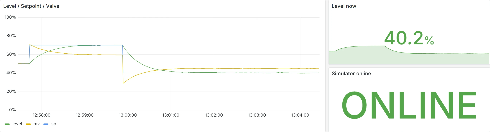
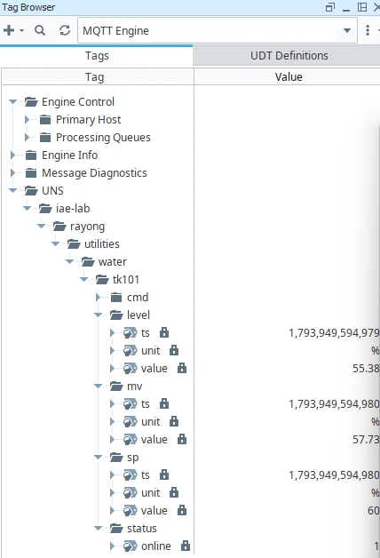

ลองนึกภาพนี้ดูครับ ระดับน้ำในถังเดียวกัน
หน้าจอ HMI บอก **62 %** รายงานประจำวันบอก **58 %** ส่วน Dashboard ของผู้จัดการบอก **60 %**

ไม่มีใครผิด ทุกระบบแค่ดึงค่ามา**คนละทาง คนละเวลา คนละรอบ**
และนี่คือสิ่งที่เกิดขึ้นเมื่อโรงงานโตขึ้นเรื่อย ๆ โดยที่ข้อมูลไม่มี**ที่อยู่เดียว**

<Quote en="Publish once. Subscribe anywhere." kicker="// EP.04 · SHARE">
ส่งข้อมูล**ครั้งเดียว** · ใครอยากใช้ก็**มาหยิบเอง**
</Quote>

ตอนนี้คือตอนสุดท้ายของซีรีส์ **Build. Test. Commission. Share.**
หลังจากสร้างระบบ ([EP.01](/blog/soft-skills-automation-engineer/)) ทดสอบกับ Digital Twin ([EP.02](/blog/digital-twin-test-before-commissioning/)) และจูน PID ด้วยหลักฐาน ([EP.03](/blog/pid-tuning-step-test-to-imc-lambda/))
ถึงเวลาเอาข้อมูลที่ได้ไป **Share** ให้ทุกฝ่ายเห็นตรงกันครับ

## ปัญหาของการต่อแบบจุดต่อจุด

โรงงานส่วนใหญ่เริ่มจากระบบไม่กี่ตัว PLC ต่อ SCADA, SCADA ต่อ Historian ทุกอย่างดูเรียบร้อย
จนวันหนึ่งมี MES, ERP, ระบบซ่อมบำรุง และ Dashboard เข้ามา แต่ละตัวก็ขอ "ต่อตรง" กับตัวที่มีข้อมูล

ลองเลื่อนเพิ่มจำนวนระบบดูครับ

<UnsHub />

ปัญหาไม่ได้อยู่แค่จำนวนเส้น แต่ทุกเส้นคือ **Driver, Mapping และคนที่ต้องจำว่ามันต่อไว้ยังไง**
พอเปลี่ยน PLC หนึ่งตัว ก็ต้องไล่แก้ทุกระบบที่ดึงค่าจากมัน และมักเจอว่าลืมไปหนึ่งเส้นตอนที่ระบบล่มแล้ว

## UNS คืออะไร ใน 4 ประโยค

**Unified Namespace (UNS)** เป็นแนวคิดที่ Walker Reynolds ทำให้เป็นที่รู้จักในวงการ IIoT สรุปสั้น ๆ ได้แบบนี้

1. **ที่อยู่เดียว** ข้อมูลสถานะปัจจุบันของทั้งองค์กรอยู่ในโครงสร้างเดียว ใครอยากรู้อะไรก็มาดูที่นี่
2. **Publish / Subscribe** ระบบที่มีข้อมูลส่งออกไปเอง ระบบที่อยากใช้ก็ Subscribe ไม่มีใครต้องรู้จักใคร
3. **จัดตามโครงสร้างธุรกิจ** ใช้ลำดับชั้นแบบ ISA-95 ไล่จากบริษัท โรงงาน พื้นที่ สาย ไปจนถึงเครื่อง
4. **ส่งเมื่อมีการเปลี่ยนแปลง** (Report by exception) ไม่ต้องไล่ Poll ค่าเดิมซ้ำทุกวินาที

<Quote en="Stop asking every machine. Let every machine tell you.">
เลิก**ไล่ถาม**ทุกเครื่อง · ให้ทุกเครื่อง**บอกเอง**
</Quote>

## MQTT ฉบับเข้าใจใน 5 นาที

UNS เป็นแนวคิด ไม่ใช่ซอฟต์แวร์ แต่เครื่องมือที่นิยมใช้สร้างมากที่สุดคือ **MQTT**
โปรโตคอลขนาดเล็กที่มี **Broker** เป็นตัวกลาง ทุกคนต่อเข้า Broker ตัวเดียว

| คำ | ความหมาย | เทียบกับงานโรงงาน |
|---|---|---|
| **Broker** | ตัวกลางรับและส่งต่อข้อความ | ตู้ Marshalling ที่ทุกสายมาจบ |
| **Topic** | ที่อยู่ของข้อมูล เป็นลำดับชั้นคั่นด้วย `/` | Tag path ใน SCADA |
| **Publish** | ส่งค่าออกไปที่ Topic | PLC เขียนค่าออก |
| **Subscribe** | ขอรับทุกค่าที่ส่งมาที่ Topic นั้น | HMI ดึง Tag มาแสดง |
| **QoS 0 / 1 / 2** | ส่งครั้งเดียว · อย่างน้อยหนึ่งครั้ง · ครั้งเดียวพอดี | ยิ่งสูงยิ่งชัวร์ แต่ช้าลง |
| **Retain** | Broker จำค่าล่าสุดไว้ให้คนที่มาทีหลัง | ค่าปัจจุบันของ Tag |
| **Last Will** | ข้อความที่ Broker ส่งแทน เมื่ออุปกรณ์หลุดไปเฉย ๆ | สัญญาณ Comm fail |

สองตัวสุดท้ายคือหัวใจของ UNS ครับ **Retain** ทำให้ใครเปิดระบบขึ้นมาก็เห็นสถานะปัจจุบันทันที
และ **Last Will** ทำให้รู้ว่าค่าที่เห็นยังสดอยู่ หรือเครื่องหลุดไปแล้ว

## ออกแบบ Topic ตาม ISA-95

ถ้า UNS คือบ้าน **Topic คือบ้านเลขที่** ตั้งดีตั้งแต่แรก ทุกระบบจะหาข้อมูลเจอเอง
ตั้งมั่วตั้งแต่แรก อีกสองปีจะไม่มีใครกล้าแก้

<TopicPath />

กฎที่เราใช้เวลาตั้งชื่อ Topic

- **ตัวเล็กทั้งหมด ไม่มีเว้นวรรค** ใช้ `-` แทน เช่น `water-treatment`
- **ไม่ขึ้นต้นด้วย `/`** เพราะจะได้ระดับแรกเป็นค่าว่าง
- **ห้ามใส่ค่าที่เปลี่ยนบ่อยไว้ใน Topic** เช่น Batch ID หรือชื่อสูตร ให้อยู่ใน Payload แทน
- **แยกคำสั่งออกจากข้อมูล** ค่าที่วัดได้อยู่ที่ `.../tk101/level` ส่วนคำสั่งอยู่ที่ `.../tk101/cmd/sp`
- **ตกลงกับทุกทีมก่อนเริ่ม** Topic คือ Contract ระหว่างระบบ เปลี่ยนทีหลังเจ็บกว่าเปลี่ยน Tag name หลายเท่า

## JSON ธรรมดา หรือ Sparkplug B

Payload ที่ส่งใน MQTT เป็นอะไรก็ได้ ซึ่งเป็นทั้งข้อดีและข้อเสีย
มาตรฐานที่วงการ IIoT ใช้กันมากคือ **Sparkplug B** ของ Eclipse Foundation

| | JSON ธรรมดา | Sparkplug B |
|---|---|---|
| อ่านด้วยตา | ✅ อ่านได้ทันที | ❌ เป็น Binary (Protobuf) |
| โครงสร้าง Topic | ออกแบบเองตาม ISA-95 | บังคับ `spBv1.0/group/type/node/device` |
| รู้ว่าเครื่องออนไลน์ไหม | ต้องทำเองด้วย Last Will | มี BIRTH / DEATH ในตัว |
| ขนาดข้อมูล | ใหญ่กว่า | เล็ก เหมาะกับเครือข่ายช้า |
| เหมาะกับ | เริ่มต้น เรียนรู้ ต่อกับ IT | โรงงานใหญ่ที่ใช้ Ignition / Edge หลายเจ้า |

ใน Lab นี้เราใช้ **JSON** เพราะเปิดดูด้วยตาได้ และ Topic เป็นโครงสร้าง ISA-95 ตรง ๆ
ส่วนงานจริงหลายที่ใช้ทั้งสองแบบคู่กัน Sparkplug B ฝั่ง Edge และ JSON ฝั่งที่ต่อไปหา IT

---

## ลงมือ: สร้าง UNS Lab ในคำสั่งเดียว

Lab นี้จำลองถังน้ำ **TK-101** ที่มี PI loop คุมระดับน้ำ ส่งค่าเข้า UNS ทุกวินาที
แล้วให้ Ignition, InfluxDB และ Grafana มา Subscribe ไปใช้ ทุกอย่างรันบน Docker ในเครื่องเดียว

<UnsLab />

<StatStrip
  items={[
    { value: '6', label: 'Container ใน Lab' },
    { value: '1', label: 'คำสั่ง docker compose up' },
    { value: '0', unit: 'บาท', label: 'ค่า License (Ignition ใช้ Trial)' },
  ]}
/>

### 1 · โครงโฟลเดอร์

```text
uns-lab/
├─ docker-compose.yml
├─ .env                 ← รหัสผ่านของ Lab (คัดลอกจาก .env.example)
├─ mosquitto/mosquitto.conf
├─ simulator/           ← ถังน้ำจำลอง (Python)
│  ├─ Dockerfile
│  └─ tank.py
├─ telegraf/telegraf.conf
└─ grafana/provisioning/ ← Datasource + Dashboard ที่โหลดอัตโนมัติ
```

### 2 · docker-compose.yml

ไฟล์เดียวที่บอกว่า Lab มีอะไรบ้าง สังเกตว่าทุก Service รู้จักแค่ `mosquitto` ไม่มีใครต่อตรงหาใครเลย

```yaml
services:
  mosquitto:            # the UNS hub (MQTT broker)
    image: eclipse-mosquitto:2
    ports: ["1883:1883"]
    volumes:
      - ./mosquitto/mosquitto.conf:/mosquitto/config/mosquitto.conf:ro
      - mosquitto-data:/mosquitto/data

  simulator:            # edge: water tank TK-101
    build: ./simulator
    environment:
      MQTT_HOST: mosquitto
    depends_on: [mosquitto]

  influxdb:             # time-series history
    image: influxdb:2.7
    ports: ["8086:8086"]
    environment:
      DOCKER_INFLUXDB_INIT_MODE: setup
      DOCKER_INFLUXDB_INIT_USERNAME: ${INFLUX_USER}
      DOCKER_INFLUXDB_INIT_PASSWORD: ${INFLUX_PASSWORD}
      DOCKER_INFLUXDB_INIT_ORG: iae-lab
      DOCKER_INFLUXDB_INIT_BUCKET: uns
      DOCKER_INFLUXDB_INIT_ADMIN_TOKEN: ${INFLUX_TOKEN}

  telegraf:             # subscriber: UNS -> InfluxDB
    image: telegraf:1.32
    environment:
      INFLUX_TOKEN: ${INFLUX_TOKEN}
    volumes:
      - ./telegraf/telegraf.conf:/etc/telegraf/telegraf.conf:ro

  grafana:              # dashboards
    image: grafana/grafana-oss:11.3.0
    ports: ["3300:3000"]   # host port 3300
    environment:
      GF_SECURITY_ADMIN_PASSWORD: ${GRAFANA_PASSWORD}
      GF_AUTH_ANONYMOUS_ENABLED: "true"   # lab only: view without login
      INFLUX_TOKEN: ${INFLUX_TOKEN}
    volumes:
      - ./grafana/provisioning:/etc/grafana/provisioning:ro

  ignition:             # SCADA / HMI
    image: inductiveautomation/ignition:8.1
    ports: ["9088:8088"]   # host port 9088
    environment:
      ACCEPT_IGNITION_EULA: "Y"
      GATEWAY_ADMIN_USERNAME: admin
      GATEWAY_ADMIN_PASSWORD: ${IGNITION_PASSWORD}
      IGNITION_EDITION: standard
      TZ: Asia/Bangkok
```

<Callout type="story" title="เจอจริงตอนรัน Lab: พอร์ตชน">
รันครั้งแรกบนเครื่องเรา Ignition กับ Grafana ขึ้นไม่ได้ เพราะเครื่องนี้ติดตั้ง Ignition (8088) และ Grafana (3000) ตัวจริงไว้ใช้งานอยู่แล้ว
วิธีแก้คือเปลี่ยนแค่พอร์ตฝั่งซ้ายของ `ports` เป็น `9088:8088` และ `3300:3000` ตัว Container ข้างในยังใช้พอร์ตเดิม ไม่ต้องแก้อะไรอื่น
</Callout>

### 3 · Broker: mosquitto.conf

ตั้งแต่ Mosquitto 2.0 ถ้าไม่ตั้งค่าอะไร Broker จะรับแค่การเชื่อมต่อจากเครื่องตัวเอง เลยต้องเปิด Listener เอง

```text
# LAB ONLY: anyone on the network can publish and subscribe.
listener 1883
allow_anonymous true
persistence true
persistence_location /mosquitto/data/
```

### 4 · Edge: ถังน้ำจำลองที่ Publish เข้า UNS

ตัวจำลองเป็นโมเดลถังง่าย ๆ ใกล้ 50 % มันทำตัวเป็น First-order ที่ K = 2 %/% และ τ = 50 s
เราเลยจูน PI ด้วย **IMC λ = 25 s** แบบเดียวกับใน [EP.03](/blog/pid-tuning-step-test-to-imc-lambda/) ได้ Kp = 1.0 และ Ti = 50 s
ส่วนที่เกี่ยวกับ UNS มีแค่นี้ครับ

```python
BASE = "iae-lab/rayong/utilities/water/tk101"

def publish(tag, value, unit):
    payload = {"value": round(value, 2), "unit": unit, "ts": int(time.time() * 1000)}
    # retain: anyone who subscribes later sees the current state at once
    client.publish(f"{BASE}/{tag}", json.dumps(payload), qos=0, retain=True)

client = mqtt.Client(mqtt.CallbackAPIVersion.VERSION2, client_id="tk101-sim")
# Last Will: if this program dies, the broker announces it for us
client.will_set(f"{BASE}/status", json.dumps({"online": 0}), qos=1, retain=True)
```

ทุกวินาทีจะได้ข้อความแบบนี้ไปที่ `iae-lab/rayong/utilities/water/tk101/level`

```json
{ "value": 52.41, "unit": "%", "ts": 1794045600000 }
```

### 5 · Subscriber: Telegraf แปลง Topic เป็น Tag ใน InfluxDB

จุดที่เราชอบที่สุดของ Lab นี้คือ **โครงสร้าง ISA-95 ใน Topic ถูกพาไปเป็น Tag ในฐานข้อมูลด้วย**
ไม่ต้อง Map ทีละค่า เพิ่มถังใหม่ก็เข้าฐานข้อมูลเองทันที

ตอนแรกเราตั้งให้ Telegraf ใช้เวลาจากฟิลด์ `ts` ใน Payload แต่ข้อความ `status` ไม่มีฟิลด์นี้ Telegraf เลยทิ้งข้อความทั้งก้อนพร้อม Error `'json_time_key' could not be found`
บทเรียนคือ **Payload ทุกตัวใน Topic เดียวกันต้องมีรูปแบบเดียวกัน** หรือไม่ก็ให้ฝั่งรับยืดหยุ่นพอ ใน Lab นี้เราเลือกให้ Telegraf ใช้เวลาที่รับข้อความแทน

พอเปิดดูใน InfluxDB จะเห็นว่าระดับชั้นของ Topic กลายเป็น Tag ครบทุกตัว

```text
_measurement  site    area       line   cell   _value
level         rayong  utilities  water  tk101  49.85
mv            rayong  utilities  water  tk101  50.07
sp            rayong  utilities  water  tk101  50
status        rayong  utilities  water  tk101  1
```

```toml
[[inputs.mqtt_consumer]]
  servers = ["tcp://mosquitto:1883"]
  topics = ["iae-lab/+/+/+/+/+"]     # data only: cmd/... is one level deeper
  data_format = "json"
  json_string_fields = ["unit"]
  fieldexclude = ["ts"]              # time = when Telegraf receives it

  [[inputs.mqtt_consumer.topic_parsing]]
    topic = "iae-lab/+/+/+/+/+"
    measurement = "_/_/_/_/_/measurement"
    tags = "_/site/area/line/cell/_"
```

### 6 · รัน แล้วดูข้อมูลวิ่ง

```bash
cp .env.example .env        # change every password first
docker compose up -d
docker compose exec mosquitto mosquitto_sub -t "iae-lab/#" -v
```

ถ้าเห็นข้อความวิ่งทุกวินาทีแบบนี้ แปลว่า UNS ทำงานแล้วครับ

```text
iae-lab/rayong/utilities/water/tk101/level {"value": 49.84, "unit": "%", "ts": 1793944487247}
iae-lab/rayong/utilities/water/tk101/sp {"value": 50.0, "unit": "%", "ts": 1793944487248}
iae-lab/rayong/utilities/water/tk101/status {"online": 1}
iae-lab/rayong/utilities/water/tk101/mv {"value": 49.93, "unit": "%", "ts": 1793944487248}
```

ลองสั่ง Setpoint ใหม่จาก Terminal ดู ถังจะค่อย ๆ ขึ้นไปที่ 70 % ภายในประมาณ 2 นาที

```bash
docker compose exec mosquitto mosquitto_pub -t iae-lab/rayong/utilities/water/tk101/cmd/sp -m "{\"value\": 70}"
```

แล้วลองทดสอบ **Last Will** ด้วยการ Kill ตัวจำลองแบบไม่ให้ตั้งตัว เหมือนไฟดับหรือสาย LAN หลุด

```bash
docker compose kill simulator
```

ในไม่กี่วินาที Broker จะประกาศแทนให้เองว่าเครื่องหลุดไปแล้ว ทุกระบบที่ Subscribe อยู่รู้พร้อมกันทันที

```text
iae-lab/rayong/utilities/water/tk101/status {"online": 1}
iae-lab/rayong/utilities/water/tk101/status {"online": 0}
```

### 7 · Grafana: Dashboard ที่โหลดมาให้แล้ว

เปิด `http://localhost:3300` จะเจอ Dashboard **TK-101** ที่ Provision ไว้ในโฟลเดอร์ `grafana/provisioning`
กราฟ Level, Setpoint และ Valve ใช้ Flux query แบบนี้

```text
from(bucket: "uns")
  |> range(start: v.timeRangeStart, stop: v.timeRangeStop)
  |> filter(fn: (r) => r.cell == "tk101" and r._field == "value")
  |> filter(fn: (r) => r._measurement == "level" or r._measurement == "sp" or r._measurement == "mv")
  |> aggregateWindow(every: v.windowPeriod, fn: mean, createEmpty: false)
  |> group()
  |> pivot(rowKey: ["_time"], columnKey: ["_measurement"], valueColumn: "_value")
  |> sort(columns: ["_time"])
```

บรรทัด `sort` สุดท้ายเราเพิ่มทีหลัง เพราะตอนรันจริง Flux คืนแถวหลัง `pivot` มาไม่เรียงเวลา กราฟเลยมีเส้นทแยงลากข้ามจอ



ภาพนี้จับจาก Lab บนเครื่องเราจริง สั่ง Setpoint 50 → 70 → 40 % ผ่าน `cmd/sp` แล้ว Level ตามเข้าไปโดยไม่ Overshoot เพราะจูนด้วย IMC แบบ Lag-dominant ตามที่เล่าไว้ใน EP.03

### 8 · Ignition: SCADA ที่ Subscribe จาก UNS

Ignition คุยกับ MQTT ผ่านโมดูล **MQTT Engine** ของ Cirrus Link
ข้อดีคือ Ignition ไม่ต้องรู้เลยว่าข้อมูลมาจาก PLC ยี่ห้อไหน รู้แค่ Topic

1. ดาวน์โหลด **MQTT Engine Module** จากหน้า Third-party modules ของ Inductive Automation ให้ตรงกับเวอร์ชัน Gateway (Lab นี้ใช้ Ignition 8.1.55 กับ MQTT Engine 4.0.37) โหลดแค่ตัว Engine พอ เพราะเรามี Mosquitto เป็น Broker แล้ว
2. เปิด `http://localhost:9088` ใน Edge หรือ Chrome แล้วไปที่ **Config → Modules → Install or Upgrade a Module** อัปโหลดไฟล์ `.modl` แล้วกดยอมรับ License และ Certificate ของ Cirrus Link
3. ไปที่ **MQTT Engine → Settings → Servers** แก้ URL ของ Server ตั้งต้น (Chariot SCADA) จาก `tcp://localhost:1883` เป็น `tcp://mosquitto:1883`
4. แท็บ **Namespaces → Custom** สร้าง Namespace ใหม่ Subscriptions เป็น `iae-lab/#` ตั้ง Root Tag Folder เป็น `UNS` และติ๊ก **JSON Payload**
5. เปิด Designer แล้วดู Tag Browser ที่ Provider **MQTT Engine**

ผลที่ได้คือ Tag ทั้งหมดงอกขึ้นมาเองตามโครง Topic ไม่ต้องสร้าง Tag ด้วยมือเลยสักตัว และเพราะติ๊ก JSON Payload ไว้ แต่ละฟิลด์ใน JSON ก็กลายเป็น Tag ย่อยให้ด้วย



ส่วนฝั่ง**สั่งงาน** เราลองรันบรรทัดนี้ใน **Tools → Script Console** ของ Designer

```python
system.cirruslink.engine.publish("Chariot SCADA", "iae-lab/rayong/utilities/water/tk101/cmd/sp", bytearray('{"value": 60}'), 1, False)
```

ไม่ถึงวินาที ตัวจำลองก็ขึ้น `new setpoint 60.0 %` และค่า `sp/value` ใน Tag Browser ก็เปลี่ยนเป็น 60 ตาม
คำสั่งเดินจาก SCADA ผ่าน Broker ไปถึงเครื่อง แล้วสถานะใหม่ก็ไหลกลับมาให้ทุกระบบเห็นพร้อมกัน นี่แหละครับ UNS ที่ทำงานครบทั้งสองทาง

<Callout type="story" title="3 เรื่องที่เจอจริงตอนต่อ Ignition">
- **ใช้ `docker cp` ใส่โมดูลแล้วติดตั้งไม่ได้** ขึ้น `Permission denied` เพราะไฟล์ที่คัดลอกเข้าไปเป็นของ root ไม่ใช่ผู้ใช้ `ignition` ทางที่ง่ายกว่าคืออัปโหลดผ่านหน้า Gateway ตรง ๆ
- **ช่อง URL ของ Server ตั้งต้นเป็น `localhost`** ซึ่งใน Container หมายถึงตัว Ignition เอง ไม่ใช่ Broker ต้องใช้ชื่อ Service ใน Compose คือ `mosquitto`
- **ปิด Docker Desktop แล้ว Gateway หายไปทั้งตัว** Designer ฟ้อง `Failed to create new Project` เปิด Docker กลับมา ทุกอย่างกลับมาครบ รวมถึงโมดูลและการตั้งค่า
</Callout>

เห็นโฟลเดอร์ `cmd` ในภาพไหมครับ Ignition Subscribe `iae-lab/#` เลยเห็นคำสั่งด้วย ในงานจริงควรคุมด้วย **ACL** ว่าใครอ่านหรือเขียน Topic คำสั่งได้บ้าง ซึ่งเป็นเรื่องในหัวข้อถัดไป

<Callout type="tip" title="Ignition Trial ใช้ฟรีได้เรื่อย ๆ">
Ignition ที่ไม่มี License จะรันในโหมด Trial ครั้งละ 2 ชั่วโมง กด Reset ที่หน้า Gateway ได้ไม่จำกัด เหมาะกับ Lab แบบนี้มาก
</Callout>

---

## ก่อนเอา UNS ไปใช้จริง

Lab นี้เปิด Broker แบบ**ใครก็ต่อได้** เพื่อให้เริ่มง่าย ซึ่งห้ามเอาไปใช้แบบนี้ในโรงงานเด็ดขาด

<Callout type="safety" title="UNS คือประตูบานใหญ่ ต้องมีกุญแจ">
- เปิด **TLS** (พอร์ต 8883) และให้ทุก Client มี **Username / Password หรือ Certificate**
- ตั้ง **ACL** ให้แต่ละระบบ Publish ได้เฉพาะ Topic ของตัวเอง และ Subscribe เฉพาะที่จำเป็น
- **คำสั่งที่เขียนกลับลงเครื่อง** (`cmd/...`) ต้องผ่าน Interlock และขอบเขตค่าที่ปลอดภัยเสมอ ตัวจำลองใน Lab ก็ Clamp Setpoint ไว้ที่ 10–90 %
- อย่าเปิดพอร์ต Broker ออกอินเทอร์เน็ต วาง Broker ตาม Zone ของ OT network และคุมการข้ามโซนตามแนวทาง **IEC 62443**
</Callout>

<Checklist
  title="Checklist ก่อนเปิด UNS ในโรงงาน"
  items={[
    'ตกลงโครงสร้าง Topic ตาม ISA-95 กับทุกทีม และเขียนเป็นเอกสาร',
    'กำหนดรูปแบบ Payload (JSON หรือ Sparkplug B) และหน่วยของทุกค่า',
    'ทุกอุปกรณ์มี Last Will และ Status topic',
    'เปิด TLS + Authentication + ACL บน Broker',
    'แยก Topic คำสั่ง (cmd) และตรวจขอบเขตค่าที่ปลายทางทุกครั้ง',
    'วางแผน Broker สำรอง (Cluster หรือ Bridge) ก่อนมีระบบสำคัญมาพึ่ง',
    'ทดสอบว่าถ้า Broker ล่ม เครื่องจักรยังทำงานต่อได้อย่างปลอดภัย',
  ]}
/>

ข้อสุดท้ายสำคัญที่สุดครับ **UNS เป็นทางเดินของข้อมูล ไม่ใช่สมองของเครื่องจักร**
Control loop และ Interlock ต้องอยู่ใน PLC เหมือนเดิม Broker ล่มเมื่อไร เครื่องต้องยังเดินต่อได้

<Quote en="The UNS carries the data. The PLC still carries the plant.">
UNS แบก**ข้อมูล** · PLC ยังแบก**โรงงาน**
</Quote>

## ปิดซีรีส์ Build. Test. Commission. Share.

สี่ตอนที่ผ่านมาคือวิธีที่เราทำงานจริงทุกโปรเจกต์

- **Build** สร้างด้วยทักษะที่ทำให้งานจบได้จริง ([EP.01](/blog/soft-skills-automation-engineer/))
- **Test** ให้ PLC ซ้อมกับ Digital Twin ก่อนแตะเครื่องจริง ([EP.02](/blog/digital-twin-test-before-commissioning/))
- **Commission** จูน PID ด้วยหลักฐาน ไม่ใช่ความรู้สึก ([EP.03](/blog/pid-tuning-step-test-to-imc-lambda/))
- **Share** เอาข้อมูลขึ้น UNS ให้ทุกคนเห็นความจริงชุดเดียวกัน (ตอนนี้)

ตอนต่อไปเราจะต่อยอดจากเรื่องกุญแจของ UNS ในบทนี้ ไปที่ **OT Security** ว่าเมื่อโรงงานเชื่อมกับ IT มากขึ้น จะล็อกประตูแต่ละบานยังไงครับ

<Quote en="Data that only one system can see isn't information. It's a secret." kicker="// END OF SERIES · JUMP TO S0">
ข้อมูลที่มีระบบเดียวเห็น **ยังไม่ใช่ข้อมูล** · มันคือ**ความลับ**
</Quote>

ถ้าลองทำ Lab แล้วติดตรงไหน หรืออยากชวนคุยเรื่อง UNS ในโรงงานของคุณ ทักมาได้ที่หน้า [ติดต่อ](/contact/) นะครับ
