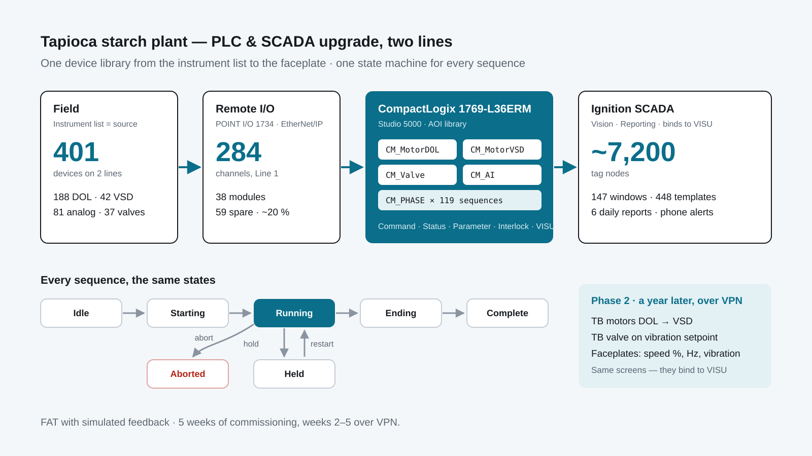

import StatStrip from '../../../components/mdx/StatStrip.astro';
import DeviceFlow from '../../../components/mdx/DeviceFlow.astro';
import PhaseMachine from '../../../components/mdx/PhaseMachine.astro';
import TbFaceplate from '../../../components/mdx/TbFaceplate.astro';

## Problem

A tapioca-starch plant ran two production lines — from the root hopper and rasper, through
extraction and hydrocyclones, to the dryer — on relay-era logic. The plant wanted both lines on one
PLC and SCADA system: start and stop each unit in a set order, hold or abort it when something goes
wrong, see why a machine will not run, and get a daily report without copying numbers by hand.

The plant is neither a full batch process nor a purely continuous one. The rasper, the turbo
cyclones, the hydrocyclones, the dryer and the dosing units each have their own start-up, normal
run and shutdown. Two lines meant more than 400 devices, and the system had to stay easy to change
long after handover.



<StatStrip items={[
  { value: '401', label: 'field devices in the instrument list' },
  { value: '230', label: 'motors — 188 DOL and 42 VSD' },
  { value: '119', label: 'phase instances on one state machine' },
  { value: '7,200', unit: 'tags', label: 'Ignition tag nodes, about' },
]} />

## My role & scope

Controls and SCADA engineer at the integrator, from tag design to the changes a year after
handover:

- **Tag and I/O engineering** — the instrument list, PLC and SCADA tags, and the I/O map to every
  POINT I/O channel
- **PLC program** in Studio 5000 for a CompactLogix 1769-L36ERM, built on an AOI library made for
  this project
- **Ignition SCADA** — screens, templates, alarms, trends, user management and the daily reports
- **FAT, on-site commissioning** with the plant's technicians, and the weekly site reports
- **Phase 2 modifications** over VPN, and the joint functional test

## Approach

### Five process areas, one name everywhere

Both lines are split into the same five areas: **Front Line** (hopper, conveyors, peeler, rasper,
decanter, SO₂ dosing), **Extraction** (turbo cyclones 1–4, fine fibre), **Separation**
(hydrocyclones, big tank, recovery tank), **Drying** (dryer, starch feeder, dust blower) and
**Utility** (waste water, slurry tank, compressor). The same names are used for the PLC programs,
the SCADA tag folders and the screens. When a technician points at a screen, the right routine
opens without any translation.

### The instrument list is the single source

Everything starts from one Excel instrument list: site, line, area, tag, description and **Type**.
The Type column is not a comment. It decides what is generated next — which AOI and UDT on the
PLC, which UDT instance in Ignition, which faceplate on the screen, and which channels go into the
FAT. Tags follow the P&ID number with a suffix for the signal (`_REM`, `_RUN`, `_START`), so one
device's signals sort together in the tag browser.

<DeviceFlow />

```
Instrument list (Excel) → PLC tags (CSV into Studio 5000) → SCADA tags (JSON into Ignition)
                        → I/O map to the module channel   → FAT / I/O test report
```

### A device library instead of 1,880 rungs

Writing 188 DOL motors by hand at ten rungs each is 1,880 rungs to change one by one. Instead,
every device is an Add-On Instruction from one library: `CM_MotorDOL`, `CM_MotorVSD`, `CM_Valve`,
`CM_ControlValve`, `CM_AI`, `CM_DI`, `CM_Flow_Counter` and `CM_PHASE`, over a thin I/O layer
(`IO_StdAI`, `IO_StdDI`, `Analog_out`).

Each device UDT has the same parts — **Command**, **Status**, **Parameter**, a 16-bit
**InterlockList** with descriptions, **RunHour** and **VISU**. The screen binds only to `VISU`,
so it never needs to know whether a DOL or a VSD sits underneath. `SimOverride` and
`FaultOverride` let the whole line be tested at a desk before any field device is connected.

Motor alarms leave the PLC as codes — breaker fault, isolator off, remote switch off, run and stop
feedback faults — and Ignition turns them into text. No strings in the controller, and a Thai
translation later changes one script.

### One state machine for every sequence

Each unit's sequence is a phase built on one shared AOI, `CM_PHASE`. The state machine is the same
everywhere; only the transition conditions (`Transition.InitOk`, `StartingOk`, `EndingOk` …) are
written per process. An alarm puts a running phase on hold, and an idle phase with an alarm is
interlocked and cannot start. Each phase also tracks its step number, step timers and done bits, so
the screen shows which step it is on, what it waits for and how many seconds are left.

<PhaseMachine />

Phase templates cover the plant's equipment types — pump, mixer, TB cyclone, hydrocyclone, add
material, dryer drying and cooling, waste water, tank, rasper — 119 instances in all: Extraction 51,
Separation 30, Front Line 26, Utility 6 and Drying 6. Where the two lines' machines differ, the
phase type is split into a Line 1 version instead of forcing one type to fit both.

### Ignition built from templates, not drawn by hand

448 template resources — motor, pump, valve, control valve, AI, DI, DO, flow meter and PID in
several sizes, plus symbols for this plant's conveyors, hopper, rasper, screw and sieve. Almost
every main template has a drop target, so dragging a UDT instance from the tag browser onto a
screen places the symbol with its parameters already bound. That is what made about 820 device
instances possible for one engineer.

Fewer than ten of the 147 windows are process screens; the rest are faceplates, popups, alarm and
trend pages and tools shared by both lines. Shared script libraries handle tags, history,
navigation, theming, dataset export and event logging, and important alarms are pushed to the
shift lead's phone over LINE with a screenshot.

The Reporting module builds six daily reports — each line at raw values, 15-minute averages and
1-hour averages — because production wanted detail and management wanted the overview.

### Room to change later

Line 1's two remote I/O panels hold 38 POINT I/O modules and 284 channels: 225 in use
(DI 117, DO 66, AI 25, AO 17) and 59 spare, about 20 %. Every spare is listed in the FAT I/O map,
so a new signal can be placed without opening a panel.

## Delivery

- **Design and programming** — instrument list, tag generation, AOI library, PLC program and
  Ignition project, with the PLC file revised from R1 to R14 for Line 1
- **FAT** — network test of the PLC and both remote I/O panels, and six I/O mapping sheets
  covering every channel of all 38 modules, spares included
- **Week 1, on site** — software installed, PLC ↔ SCADA network set up, I/O and instrument checks
  with the plant's technicians
- **Weeks 2–3, over VPN** — remote I/O tests under different running conditions, analog scaling
  and units checked, screen layouts revised
- **Week 4** — every phase run through start-up, normal run and shutdown, with transitions,
  interlocks and alarms tested and the logic tuned for smooth changes
- **Week 5** — final I/O check, screens, controls and alarms signed off for production
- **Phase 2, the next year** — three changes, all over VPN, then one week of functional tests
  with the plant's engineers

The phase 2 changes were on the turbo cyclones. TB4/1 on Line 1 and both TB4/1 and TB4/2 on Line 2
moved from DOL to VSD, with a speed reference instead of an on/off contactor command; TB4/2 on Line
1 stayed DOL as the scope of work specified. The TB valve now opens and closes on vibration: below
the setpoint it opens, above it closes, to protect the cyclone without waiting for an operator.
The faceplates gained live speed (%) and frequency (Hz), the vibration value and a setpoint per
station.

<TbFaceplate />

Because `CM_MotorVSD` was already in the library and the screens bind to `VISU`, the drive change
was a control-module swap and a new reference, not new VSD logic or a rebuilt screen.

## Result

- Two lines run on one PLC and SCADA system, with every device and every sequence built the same way
- Operators learn the phase screen once and use it on every machine — start, hold, restart, abort
- "Why won't it run?" is answered on screen: the interlock bit, the current step and its timer
- Daily reports at three resolutions for production and management, and key alarms on the phone
- A year later, the drive and interlock changes were made and tested remotely without stopping
  the line for new I/O, because the spares and the I/O map were ready

## What I would do next

The same structure is a good base for newer tools. Ignition Perspective would put the phase and
device faceplates on phones and the big screen from one project. Publishing the `VISU` layer to a
Unified Namespace over MQTT would let reports and dashboards read the plant without new links to
the PLC. And keeping the CSV and JSON tag exports in Git would turn the R1 → R14 history into a
reviewable diff.

## Skills used

Rockwell CompactLogix and Studio 5000 (ladder, Add-On Instructions, UDTs) · POINT I/O over
EtherNet/IP · phase-based sequence control with a shared state machine · device-library design
(Command / Status / Parameter / Interlock / VISU) · Ignition Vision templates, drop targets, UDTs
and Jython scripts · Ignition Reporting · tag generation from an instrument list · FAT with
simulated feedback · commissioning with plant technicians · remote commissioning and modification
over VPN · DOL to VSD conversion.
